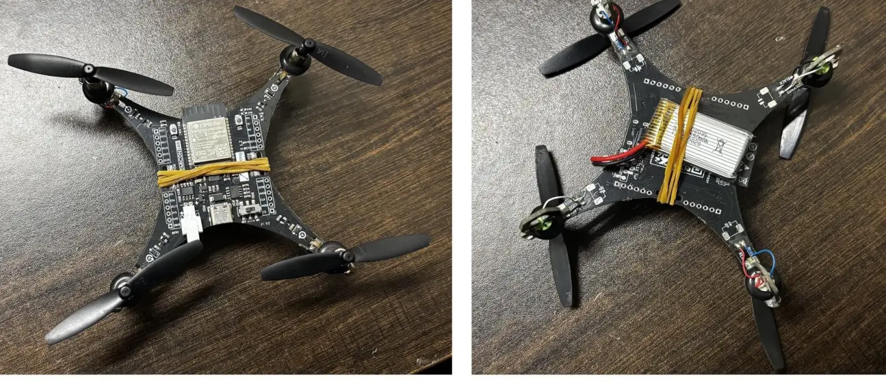

## The problem

Small drones almost always use omnidirectional antennas. They don't need pointing, but they spread their energy everywhere, so the link budget runs out early. The drone I'm using flies on 2.4 GHz Wi-Fi, and links like that typically give up somewhere around a hundred metres in the open, well before the drone itself has to.

The usual fixes all cost something:

- **More transmit power** drains a small battery and runs into the legal limits on licence-exempt bands.
- **A directional antenna on a pan-tilt mount** needs motors and GPS reports from the drone, and stops working the moment the telemetry it depends on drops.
- **Full digital beamforming** needs a separate receiver behind every antenna and serious maths, which is way past a student budget.

I wanted a ground station that extends the link with cheap parts, one receiver, and computation small enough for a microcontroller.

## Constraints

- **One receiver.** The four antenna signals are summed before they reach the radio, so I never see them separately. Classic direction-finding (MUSIC, ESPRIT) is off the table. All I get is the signal strength and SNR of whatever beam is currently pointed.
- **A microcontroller does the thinking.** No Raspberry Pi, no laptop in the loop.
- **Stock drone.** I add one LoRa module and one firmware task, and leave the airframe and flight control alone.
- **Scope.** Receive-only, steering in azimuth only, one drone at a time, and campus-scale tests at low power.

## How it works

The drone is a LiteWing, an ESP32-S3 micro-drone. I added an RFM95W LoRa module on its SPI bus, and it sends a 13-byte telemetry packet at 915 MHz about five times a second. Wi-Fi still carries control. LoRa carries the telemetry, which is the link I'm improving. Every LoRa packet arrives with an RSSI and SNR reading, which turn out to be exactly the inputs the beam selector needs.

On the ground, four [printed dipoles](/work/pcb-printed-dipoles/) sit 164 mm apart (half a wavelength) on a wooden boom. Each one feeds a two-bit switched-line phase shifter: four HMC349 RF switches choosing between lengths of RG316 coax, giving 0°, 90°, 180° or 270°. A four-way combiner adds the shifted signals and passes them to a single LoRa receiver.

From the 64 phase combinations the array can actually make, I derived a codebook of 12 beams covering ±90°.

The ESP32-S3 on the ground station sounds a handful of those beams, builds a 24-number feature vector from the signal strength of each sounding, and runs a 1,532-parameter neural net (an MLP, quantised to INT8 and run with TensorFlow Lite for Microcontrollers). The net picks the beam that points at the drone, and the ESP32 sets the eight control lines on the phase shifters.

To evaluate it, I compare a fixed-beam baseline firmware against the ML firmware, swapping between them with an over-the-air update.

## The hard part (so far)

**The drone speaks the wrong language.** The LiteWing talks 2.4 GHz Wi-Fi and my station listens at 915 MHz. I could have redesigned the array for 2.4 GHz, but Wi-Fi RSSI is noisy (rate adaptation, bursty traffic) and there's 8.4 dB more path loss. Building my own drone was out of scope. So the drone got a second radio: Wi-Fi for control, LoRa for telemetry, the same split real UAV systems use.

**Phase shifters at 915 MHz.** The affordable digital phase-shifter modules I found were specified for 1.7 to 2.2 GHz, and running RF parts out of band gives unpredictable phase steps. Analogue ones would have needed two devices per channel plus a DAC and a 0 to 15 V amplifier each. Switched coax lines won: the phase steps are set by cable length, so they repeat exactly every time. That matters, because the neural net learns a fixed mapping and needs a given setting to always mean the same physical phase. The trade-off is coarse two-bit resolution, which costs about 1 dB of peak gain.

Early on I also designed in charge pumps and level shifters because I'd assumed the HMC349 needed a negative control voltage. The datasheet said a single 3 to 5 V supply and logic-high from 2.0 V. The ESP32's 3.3 V pins drive it directly, and the extra circuitry went in the bin.

**Measuring with a cheap VNA.** I measured the velocity factor of my RG316 spool, which sets the delay-line lengths, by cutting 40 mm off an open-ended cable and comparing phase. The answers wandered from 0.62 to 0.75 across frequency, and 20 to 28 % of the points showed a reflection bigger than 1, which a passive cable can't do. So that result is indicative only, and the delay lines get checked directly instead.

## Where it stands

Everything tested so far has met its acceptance criterion:

- The four antenna elements are matched at 915 MHz without trimming ([details](/work/pcb-printed-dipoles/)).
- The bench LoRa link delivered 685 of 704 packets.
- In simulation, the model gives up only 0.47 dB on average, against 1.66 dB for just keeping the strongest beam it sounded. Quantised to INT8 it still picks the best beam 84.7 % of the time, down from 86.1 % at full precision.

The simulation uses an ideal array with 2 dB of noise and no coupling between elements, so the model will be fine-tuned on data from the real array.

<!-- TODO(victor): fixed-beam vs ML comparison chart (SNR/RSSI) goes here, e.g.
 -->

Still to do: characterise the phase shifters, run the model on the ESP32-S3 and time it, verify the beams against a transmitter at surveyed bearings, then compare fixed-beam and ML firmware with the drone on a pole, and finally in flight.
